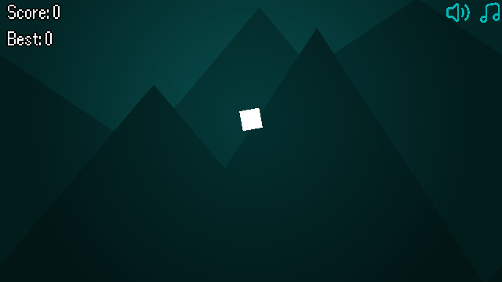
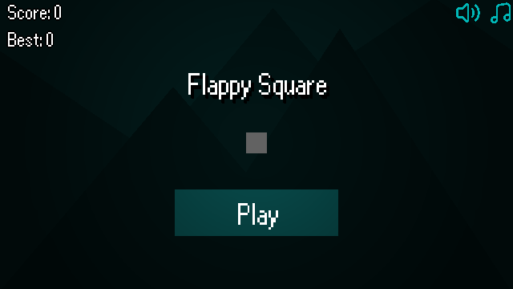

# Flappy Square

My take on Flappy Bird, made with Godot 4.5: a square instead of a bird, walls instead of pipes, and one
button to stay in the air.

It's game 1.5 of my [20 Games Challenge](https://20_games_challenge.gitlab.io/), where you remake a list of
classic games to learn how they're built. The first game is Pong or Flappy Bird, so I did both. This one
took me two days in November 2025.

**Play it in your browser or download it: https://kozumagames.itch.io/flappy-bird**

## How to play

Flap to go up, let go to fall. Every gap you get through is a point, and touching a wall, the floor or the
ceiling ends the run. Your best score is saved.

The walls come at random intervals, and each gap moves up or down a little from the last one.

| Key | Does |
| --- | --- |
| `Space` or left click | flap, and press Play or Restart |
| `M` | mute the music |
| `S` | mute the sound effects |

The two icons in the top right corner do the same as `M` and `S`.

## What I learned

- **Object pooling.** Walls that leave the screen are hidden and reused instead of being freed and
  instantiated again.
- **Lights and shadows in 2D.** There's no sprite in the game. The square carries a `PointLight2D` and every
  wall has a `LightOccluder2D`, so the walls cast shadows on the background. The mountains are stretched
  prism meshes on a few `ParallaxLayer`s.
- **Saving.** The best score is written to a small JSON file in `user://`.
- **Audio buses.** Music and sound effects go to their own bus, which is what the mute buttons toggle.
- **Input order.** `Space` presses the Restart button and also flaps. Reading the flap in
  `_unhandled_input()` lets the button take the press first, so restarting doesn't make you jump.

## Running it

Open `project.godot` with [Godot 4.5](https://godotengine.org/download/) or newer and press F5. The export
presets for the web, Windows and Linux are already set up.

- `core/`: the game scene, the wall spawner, the background and the music
- `entities/`: the square and a single wall
- `UI/`: the title screen, the game over screen and the sound buttons
- `assets/`: the font, the sounds and the two icons

## Credits

- Font: [Ari-W9500 Condensed](https://fontstruct.com/fontstructions/show/2378507/ari-w9500-3) by Catterio
  Sylt, under the SIL Open Font License (`assets/ari-w9500-OFL.txt`)
- Sounds from Pixabay, under the Pixabay Content License:
  [bird chipping](https://pixabay.com/sound-effects/nature-bird-chipping-426107/) by 佳镁Summer (the music),
  [Wing Flap 1](https://pixabay.com/sound-effects/film-special-effects-wing-flap-1-6434/) and
  [Game Over Arcade](https://pixabay.com/sound-effects/film-special-effects-game-over-arcade-6435/) by
  freesound_community,
  [point smooth beep](https://pixabay.com/sound-effects/film-special-effects-point-smooth-beep-230573/) by
  RibhavAgrawal
- Icons from SVG Repo: [sound on](https://www.svgrepo.com/svg/378708/sound-on) from Akar Icons by
  artcoholic (MIT), [sound](https://www.svgrepo.com/svg/491079/sound) from KeyIcons Interface Icons by
  Elnodos (CC BY)

The code is under the MIT license.
